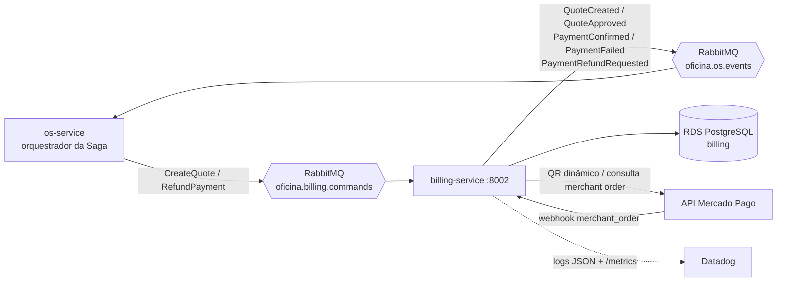

# Orçamento e Pagamento

Serviço independente de orçamentos e registros de pagamento, com banco
PostgreSQL exclusivo. As APIs de pagamento ficam privadas no cluster; a
confirmação de um gateway é recebida em `POST /payments/{id}/verify` e protegida
por `PAYMENT_PROVIDER_TOKEN`.

Execute `docker compose up --build` e acesse `http://localhost:8002/docs`.
Para execução local fora do Docker, rode `alembic upgrade head` antes de iniciar
o servidor.
Testes e qualidade: `uv sync --dev && uv run pytest --cov=app --cov-report=term-missing --cov-fail-under=80 -q && uv run ruff check --select E4,E7,E9,F app tests`.

## API e Saga

- `POST /quotes` cria orçamento idempotente por `order_id`.
- `POST /quotes/{id}/approval` registra aprovação e publica `QuoteApproved` no RabbitMQ.
- `POST /quotes/{id}/payments` registra pagamento pendente. Com o Mercado Pago configurado, cria o pedido QR dinâmico e retorna `qr_data` para geração do código.
- `POST /payments/mercado-pago/webhook` recebe a notificação `merchant_order` do Mercado Pago, consulta a merchant order na API e publica `PaymentConfirmed` ou `PaymentFailed` para o orquestrador OS (sem mensageria, avisa o OS por REST quando aprovado).
- `POST /payments/{id}/verify` recebe confirmação/recusa assinada pelo gateway
  configurado e publica `PaymentConfirmed` ou `PaymentFailed` para o orquestrador OS.
- `/internal/payments/{id}/compensate` registra a necessidade de estorno após
  falha de reserva do estoque. Sem integração com um adquirente, o serviço não
  declara que o dinheiro foi devolvido: o pagamento fica `REFUND_REQUIRED` para
  reconciliação com o provedor.

Configure `OS_SERVICE_URL`, `INTERNAL_SERVICE_TOKEN` e `PAYMENT_PROVIDER_TOKEN`.
Para Mercado Pago QR dinâmico, configure também `MERCADO_PAGO_ACCESS_TOKEN`,
`MERCADO_PAGO_USER_ID`, `MERCADO_PAGO_POS_ID` e `MERCADO_PAGO_NOTIFICATION_URL`.
Cadastre o webhook público em
`POST /api/v2/payments/mercado-pago/webhook` (encaminhado pelo gateway para o
serviço) para o Mercado Pago notificar a aprovação
através de um `merchant_order`. O access token, o user ID e o POS devem pertencer
à mesma conta Mercado Pago e o POS deve estar cadastrado previamente no painel.
No Kubernetes, essas variáveis vêm do secret `billing-service-secrets` (chaves
`mercado-pago-access-token`, `mercado-pago-user-id`, `mercado-pago-pos-id` e
`mercado-pago-notification-url`); a migration `0002_mercado_pago` adiciona
`qr_data` e `provider` ao pagamento.
Use o mesmo token interno no OS e Inventory.
Configure `JWT_SECRET_KEY` e `JWT_ALGORITHM` para validar os mesmos tokens
assinados pela Lambda/API legada; clientes só acessam orçamentos próprios.
O namespace também precisa do secret `ghcr-pull` para leitura de imagens privadas
no GHCR.

Com `MESSAGING_ENABLED=true`, o serviço consome `CreateQuote` e `RefundPayment`
da fila durável `oficina.billing.commands` e publica os resultados em
`oficina.os.events`. Configure `RABBITMQ_URL`; em Kubernetes, o deployment lê
esse valor do secret `microservices-secrets`, chave `rabbitmq-url`. Sem mensageria,
as rotas internas REST continuam disponíveis para compatibilidade.
O Billing acessa somente seu banco PostgreSQL. O OS não acessa o banco do Billing.

O RDS exclusivo é definido em `infra/`. Valide com
`terraform -chdir=infra init -backend=false`, `terraform -chdir=infra validate`
e `terraform -chdir=infra plan` após fornecer as variáveis requeridas. O apply
exige backend de estado remoto e revisão do plano antes de provisionar recursos.

## Arquitetura do serviço



A especificação completa da API está em [`openapi.json`](./openapi.json) e em `/docs` com o serviço rodando.

## Mensageria e rastreamento

- Toda mensagem publicada repassa o `correlation_id` recebido, então uma OS pode ser seguida de ponta a ponta nos logs dos três serviços.
- As filas são declaradas com `x-dead-letter-exchange: ""` e `x-dead-letter-routing-key: <fila>.dlq`: mensagens que falham no processamento vão para `oficina.billing.commands.dlq` em vez de serem descartadas. Como o argumento de declaração mudou, as filas antigas precisam ser apagadas no broker antes do primeiro deploy.

## Observabilidade

- Logs JSON com `correlation_id`, rota, status e latência de cada requisição (mesmo formato do OS).
- `GET /metrics` com total de requisições, erros, latência e eventos publicados/consumidos.
- O cabeçalho `X-Correlation-ID` é aceito na entrada e devolvido na resposta.

## Evidência de cobertura (94% > 80% exigido)

```text
Name                   Stmts   Miss  Cover
------------------------------------------
app/__init__.py            0      0   100%
app/auth.py               28      0   100%
app/main.py              326     23    93%
app/messaging.py          78      6    92%
app/observability.py      59      2    97%
------------------------------------------
TOTAL                    491     31    94%
31 passed
```

## CI/CD

`.github/workflows/ci-cd.yml`: testes com gate de 80%, Ruff, **SonarCloud obrigatório com Quality Gate** (`SONAR_TOKEN` precisa estar nos secrets do repo), validação do Terraform, build/push da imagem no GHCR e deploy no EKS.
